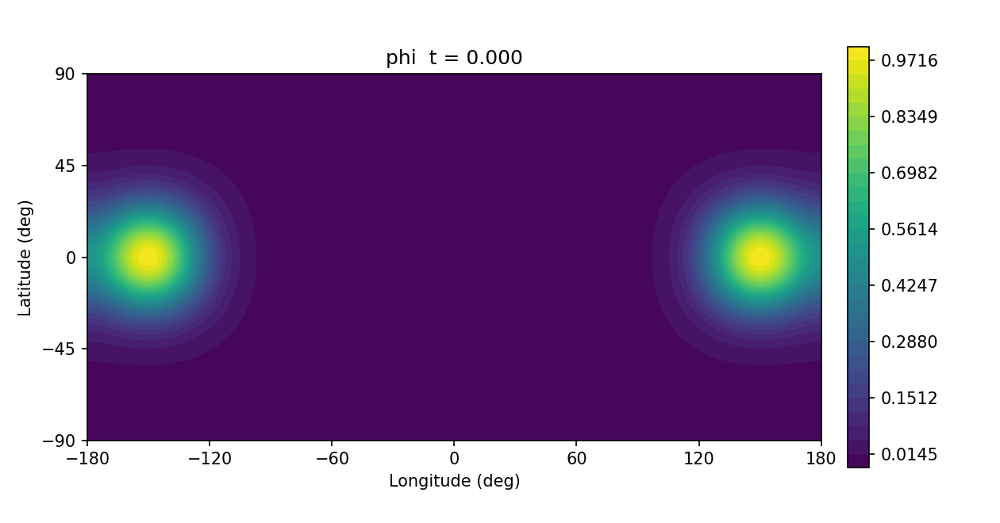
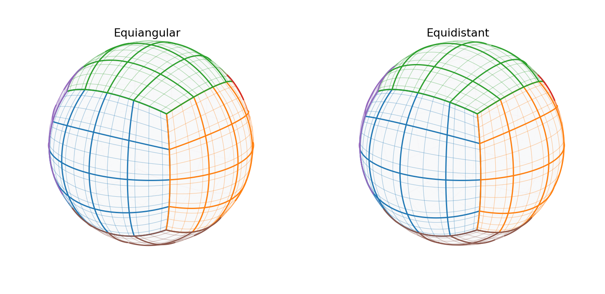
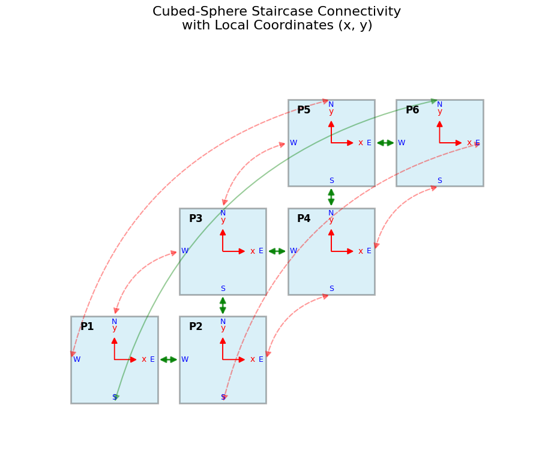
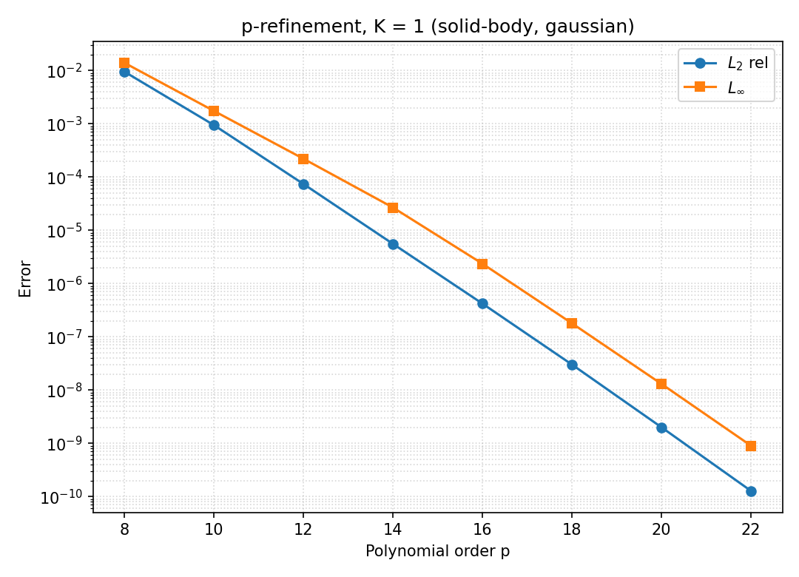
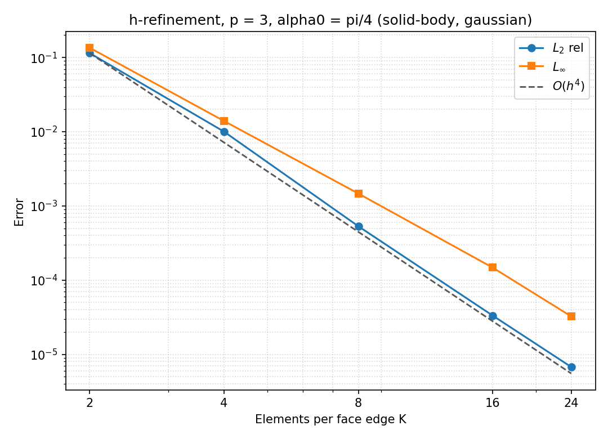
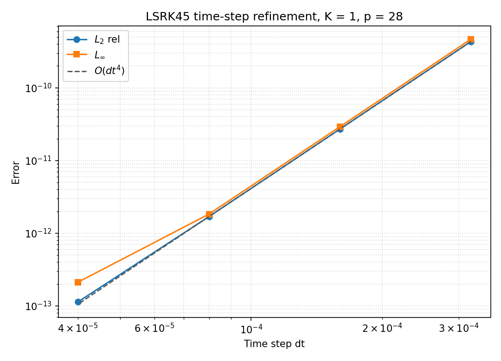

# cubesphere

[](https://github.com/Funtrollor/cubesphere/actions/workflows/ci.yml)
[](LICENSE)


**English** | [繁體中文](README.zh-TW.md)

A high-order **cubed-sphere spectral element** solver for transport on the sphere, written in pure Rust,
with an experimental GPU backend built on NVIDIA's pure-Rust CUDA toolchain
([`cuda-oxide`](https://github.com/NVIDIA/cuda-rust)).

It solves the scalar advection equation `∂φ/∂t + ∇·(φu) = 0` on a sphere of radius `R` with:

- **Legendre–Gauss–Lobatto spectral elements** on a `6 × K × K` cubed-sphere grid, with the
  **equiangular** or **equidistant** gnomonic projection;
- a **split-form volume divergence** with **SBP-SAT** interface coupling. The discrete mass is
  conserved to machine precision (~1e-15) for every mesh, projection and wind field;
- a selectable **α-flux family** (upwind, central or blended) with a **discrete energy diagnostic**;
- **Carpenter–Kennedy low-storage RK45** time stepping with Neumaier-compensated time accumulation,
  which reaches the f64 round-off floor (L2 ≈ 3e-14);
- generic **`f64` / `f32`** precision, a **Rayon** multi-core CPU backend, and **VTK / CSV / JSON** output.

Verified: exponential p-convergence, `O(h^{p+1})` h-convergence, 4th-order temporal convergence,
cross-pole advection without polar singularities, and the Nair & Lauritzen (2010) deformational flow.



---

## Contents

- [Quick start](#quick-start)
- [Using it as a library](#using-it-as-a-library)
- [Workspace layout](#workspace-layout)
- [Numerical method](#numerical-method)
- [Verification and benchmarks](#verification-and-benchmarks)
- [Visualization](#visualization)
- [GPU backend](#gpu-backend-experimental)
- [Contributing, citing, license](#contributing-citing-license)

---

## Quick start

You need stable Rust **1.87 or newer**. No GPU or CUDA toolkit is needed for the CPU workspace.

```bash
git clone https://github.com/Funtrollor/cubesphere.git
cd cubesphere
cargo test --workspace --release           # unit + verification tests
cargo build --release -p cubesphere-cli    # builds target/release/cubesphere
```

Common commands:

```bash
# Mesh info and surface-area quadrature accuracy
./target/release/cubesphere info --k 8 --order 4 --projection equiangular

# One revolution of solid-body rotation tilted 45° (crosses cube corners), with VTK + JSON output
./target/release/cubesphere run --k 8 --order 4 --wind solid-body --initial gaussian \
  --alpha0-deg 45 --periods 1.0 --cfl 0.5 \
  --vtk-out out/solid_final.vtu --json-out out/solid_metrics.json

# Nair & Lauritzen Case 4 deformational flow, writing a ParaView time series
./target/release/cubesphere run --k 8 --order 5 --wind deformational --initial twin-gaussian \
  --periods 1.0 --frames 20 --pvd-dir out/deform_anim

# Convergence studies: h-, p- or dt-refinement, with an optional CSV report
./target/release/cubesphere converge --mode h --ks 2,4,8,16,24 --order 3 \
  --alpha0-deg 45 --wind solid-body --initial gaussian --csv-out out/h_conv.csv
./target/release/cubesphere converge --mode p --k 1 --orders 8,10,12,14,16,18,20,22 \
  --alpha0 0 --wind solid-body --initial gaussian --csv-out out/p_conv.csv
./target/release/cubesphere converge --mode t --k 1 --order 28 --alpha0 0 \
  --wind solid-body --initial gaussian --dts 3.2e-4,1.6e-4,8.0e-5,4.0e-5

# Numerical flux: upwind (default) | central | a blending weight alpha in [0, 1]
# --frames also prints the energy history and stores it as energy_history in the JSON report
./target/release/cubesphere run --k 4 --order 3 --wind solid-body --initial gaussian \
  --alpha0-deg 45 --flux central --frames 10 --json-out out/central_metrics.json

# Multi-threaded throughput benchmark
./target/release/cubesphere bench --k 16 --order 4 --steps 200 --precision f64
```

Run `./target/release/cubesphere --help` for every option.

---

## Using it as a library

The crates compose directly. The workspace ships this runnable example:

```bash
cargo run --release -p cubesphere-backend-cpu --example solid_body
```

```rust
use std::f64::consts::FRAC_PI_4;
use std::sync::Arc;

use cubesphere_backend_cpu::CpuBackend;
use cubesphere_core::{CubedSphereMesh, MeshConfig, ProjectionKind};
use cubesphere_equations::{GaussianBell, ScalarAdvection, SolidBodyRotation};
use cubesphere_io::compute_diagnostics;
use cubesphere_solver::{run_lsrk45_with_dt, NumericalFlux, SimulationConfig};

// 6 * 8 * 8 elements of polynomial order 4 on the unit sphere.
let mesh = Arc::new(CubedSphereMesh::<f64>::from_config(MeshConfig {
    radius: 1.0,
    num_elem_per_face: 8,
    poly_order: 4,
    projection: ProjectionKind::Equiangular,
}));
let equation = ScalarAdvection::solid_body(
    SolidBodyRotation::new(FRAC_PI_4, None),
    Arc::new(GaussianBell::default()),
);
let backend = CpuBackend::from_equation(Arc::clone(&mesh), &equation)
    .with_flux(NumericalFlux::Upwind);

// One revolution at CFL 0.5; `None` derives dt from the CFL number.
let out = run_lsrk45_with_dt(&backend, &equation, &SimulationConfig::default(), None)
    .expect("CPU backend never fails");
let exact = equation.evaluate_exact(&mesh, out.t_final);
let m = compute_diagnostics(&mesh, &out.initial, &out.final_state, exact.as_deref());
// m.l2_rel ≈ 3.2e-5, m.mass_rel_err ≈ 3e-15
```

Custom wind fields and initial conditions plug in through the `WindField` and `ScalarField` traits
in `cubesphere-equations`. API documentation: `cargo doc --workspace --no-deps --open`.

> The crates are pre-1.0. The API may change between minor versions; see [CHANGELOG.md](CHANGELOG.md).

---

## Workspace layout

```
cubesphere/
├── crates/
│   ├── cubesphere-core/          # FloatScalar (f64/f32), LGL basis, projections, 6·K·K mesh topology
│   ├── cubesphere-equations/     # ScalarAdvection, wind fields, initial fields
│   ├── cubesphere-solver/        # ComputeBackend<T> trait, NumericalFlux, CFL, LSRK45
│   ├── cubesphere-backend-cpu/   # Rayon backend, verification tests, examples/
│   ├── cubesphere-io/            # error norms, mass/energy diagnostics, VTK/CSV/JSON
│   ├── cubesphere-cli/           # the `cubesphere` command-line tool
│   └── cubesphere-backend-cuda/  # experimental GPU backend (separate workspace)
├── scripts/                      # Python plotting scripts
├── docs/                         # CUDA setup guides and README figures
└── archive/prototype/            # the original Jupyter prototype and course report
```

The dependency graph is strictly layered:

```
cubesphere-cli ─► cubesphere-backend-cpu / cubesphere-io ─► cubesphere-solver ─► cubesphere-equations ─► cubesphere-core
                                                                   ▲
cubesphere-backend-cuda (standalone workspace) ────────────────────┘  implements ComputeBackend<T>
```

The CUDA crate is excluded from the root workspace, so `cargo test` never needs a GPU, the CUDA toolkit
or a nightly toolchain.

---

## Numerical method

**Grid.** Each of the six cube faces is split into `K × K` elements with local angular coordinates
`(α, β) ∈ [-π/4, π/4]²`. Both projections have analytical Jacobians, and unit tests check them
against the numerical metric:
equiangular `√g = R² / (ρ³ cos²α cos²β)` with `x = tan α`, `y = tan β`, and
equidistant `√g = (4/π)² R² / ρ³` with `x = 4α/π`, `y = 4β/π`, where `ρ = √(1 + x² + y²)`.



The faces are connected in a staircase layout:



**Wind.** Solid-body rotation is evaluated as `u = ω × r` in 3-D Cartesian space and projected onto
the contravariant basis `(e^α, e^β)`, so there is no `cos θ → 0` singularity at the poles.

**Space.** The volume term uses the split form of the divergence. Elements are coupled weakly through
SAT penalties of the α-flux family,
`SAT = -½ (v_n − α|v_n|)(q_out − q_in) / w`.
`α = 1` is upwind and dissipates energy at interfaces; `α = 0` is central and its interface coupling
is exactly energy neutral (the tests check that `ML + LᵀM` is diagonal). Every α conserves mass.

**Time.** Carpenter–Kennedy 5-stage, 4th-order low-storage RK. The time step is
`Δt = CFL · π / (2 K p² ν_max)`, where `ν_max = max(|u^α| + |u^β|)`, which is independent of the radius `R`.

---

## Verification and benchmarks

All numbers below come from `cargo build --release`. The convergence and benchmark tables were run on an
Intel Xeon Platinum 8481C (2 vCPUs); the flux/energy table was run on a Windows 11 workstation.
Reproduce the tables with the `converge` commands above and plot them with
[`scripts/plot_convergence.py`](scripts/plot_convergence.py).

### p-refinement (`K = 1`, `α0 = 0`, gaussian, equiangular, CFL 0.5)

| p | DOFs | L2 rel. error | L∞ error | mass rel. error |
| --- | --- | --- | --- | --- |
| 8 | 486 | 9.50e-3 | 1.39e-2 | 1.2e-15 |
| 12 | 1014 | 7.39e-5 | 2.20e-4 | 1.5e-15 |
| 16 | 1734 | 4.19e-7 | 2.35e-6 | 9.9e-16 |
| 20 | 2646 | 2.00e-9 | 1.30e-8 | 5.0e-16 |
| 22 | 3174 | 1.27e-10 | 9.00e-10 | 1.3e-15 |



### h-refinement (`p = 3`, `α0 = π/4` across cube corners; theory `O(h⁴)`)

| K | DOFs | L2 rel. error | order | L∞ error | order | mass rel. error |
| --- | --- | --- | --- | --- | --- | --- |
| 2 | 384 | 1.14e-1 | – | 1.35e-1 | – | 8.2e-16 |
| 4 | 1536 | 1.00e-2 | 3.51 | 1.39e-2 | 3.28 | 2.1e-15 |
| 8 | 6144 | 5.32e-4 | **4.24** | 1.47e-3 | 3.25 | 2.0e-15 |
| 16 | 24576 | 3.33e-5 | **4.00** | 1.47e-4 | 3.31 | 1.8e-15 |
| 24 | 55296 | 6.75e-6 | **3.93** | 3.25e-5 | 3.73 | 8.3e-16 |

With `p = 4` the observed L2 order is 4.84 at `K = 16` (theory `O(h⁵)`).



### Time-step refinement (`K = 1`, `p = 28`, LSRK45; theory `O(Δt⁴)`)

| Δt | steps | L2 rel. error | order |
| --- | --- | --- | --- |
| 3.2e-4 | 3125 | 4.33e-10 | – |
| 1.6e-4 | 6250 | 2.71e-11 | **4.00** |
| 8.0e-5 | 12500 | 1.69e-12 | **4.00** |
| 4.0e-5 | 25000 | 1.13e-13 | **3.90** |



### Other verification

- **Machine-precision floor:** a single-element Gaussian (`K = 1`, `p = 32`, CFL 0.125) reaches
  L2 = 3.4e-14; a constant field is preserved exactly (all errors `0`).
- **Cross-pole advection** (`K = 2`, `α0 = π/2`): exponential p-convergence down to 1.0e-7 at `p = 12`.
- **Nair & Lauritzen Case 4** (`p = 5`, twin Gaussian, `T = 5`): L2 = 1.78e-1 → 2.14e-2 → 2.42e-3 for
  `K = 4, 8, 12`, with mass errors below 4e-15.

### Numerical flux and energy (`K = 4`, `p = 3`, `α0 = π/4`, one revolution)

| initial field | flux | energy change `E(T)/E(0) − 1` | L2 rel. error |
| --- | --- | --- | --- |
| gaussian | upwind | −1.59e-3 (monotone decay) | 1.00e-2 |
| gaussian | α = 0.5 | −1.01e-3 | 9.23e-3 |
| gaussian | central | +1.06e-5 (oscillates) | 1.54e-2 |
| cosine bell | upwind | −2.51e-1 | 3.61e-1 |
| cosine bell | central | −3.52e-5 | 6.29e-1 |

Upwind trades energy dissipation for smaller errors. Central barely dissipates but has larger dispersion
error, which is most visible on the only-C¹ cosine bell.

### CPU throughput (`cubesphere bench`, 200 steps = 1000 RK stages, 2 vCPUs)

| mesh | DOFs | precision | ms / step | MDOF-stages/s |
| --- | --- | --- | --- | --- |
| K = 8, p = 4 | 9,600 | f64 | 1.17 | 41.0 |
| K = 16, p = 4 | 38,400 | f64 | 3.07 | 62.5 |
| K = 16, p = 4 | 38,400 | f32 | 3.04 | 63.1 |

---

## Visualization

- `run --pvd-dir <dir> --frames <N>` writes a ParaView time series (`frame.pvd` plus `.vtu` files).
  Each `(p+1)²` element is split into `p²` `VTK_QUAD` cells.
- `run --vtk-out <file.vtu>` writes the point fields `phi`, `initial`, `exact` (when available), `error`
  and `sqrt_g`.

Three Python scripts in [`scripts/`](scripts/) make figures without ParaView. They need only
`numpy`, `matplotlib` and `pillow`:

| script | input | output |
| --- | --- | --- |
| [`plot_convergence.py`](scripts/plot_convergence.py) | CSV files from `cubesphere converge --csv-out` | convergence curves; detects h/p/t mode and adds `O(h^{p+1})` or `O(Δt⁴)` reference lines |
| [`plot_grids.py`](scripts/plot_grids.py) | `--k`, `--order` | 3-D grids for both projections, using the solver's face mapping |
| [`pvd_to_gif.py`](scripts/pvd_to_gif.py) | `frame.pvd` from `cubesphere run --pvd-dir` | longitude–latitude animated GIF with a fixed colour scale |

```bash
pip install numpy matplotlib pillow
python scripts/plot_convergence.py out/p_conv.csv -o docs/images/p_convergence.png
python scripts/plot_grids.py --k 4 --order 4 -o docs/images/grids.png
python scripts/pvd_to_gif.py out/deform_anim/frame.pvd -o docs/images/deformational.gif --fps 6
```

---

## GPU backend (experimental)

[`crates/cubesphere-backend-cuda`](crates/cubesphere-backend-cuda/) implements the same
`ComputeBackend<T>` trait (f64 and f32) with NVIDIA's [`cuda-rust`](https://github.com/NVIDIA/cuda-rust)
(`cuda-oxide`). The volume term and all four SAT edges run in one fused kernel with one thread per
degree of freedom, and the whole LSRK45 loop stays in device memory.

On an RTX 5070 Ti (sm_120, CUDA 12.9, `cargo-oxide 0.4.0`), the `gpu_parity` checker matches the CPU
backend to about 1e-15 in f64 for the upwind, central and blended fluxes, and to about 3e-6 in f32.

It is a **separate workspace** that needs an NVIDIA GPU, the CUDA toolkit, `libclang` and a pinned
toolchain, and it depends on git-only crates, so it is not published to crates.io. Setup guides:
[native Windows 11](docs/WINDOWS_CUDA_OXIDE.md) · [WSL2 Ubuntu 24.04](docs/WSL2_CUDA_OXIDE.md).

```powershell
cd crates\cubesphere-backend-cuda
cargo oxide doctor
cargo oxide run --bin gpu_parity
```

---

## Contributing, citing, license

- Contributions are welcome. See [CONTRIBUTING.md](CONTRIBUTING.md); every numerical change needs a
  verification test.
- If you use cubesphere in research, please cite it using [`CITATION.cff`](CITATION.cff)
  (GitHub's "Cite this repository" button generates BibTeX).
- The project started as a university course project. The original Jupyter prototype and report are
  kept in [`archive/prototype/`](archive/prototype/), and the interactive demo is at
  <https://funtrollor.github.io/cubesphere/>.
- Released under the [MIT License](LICENSE).
