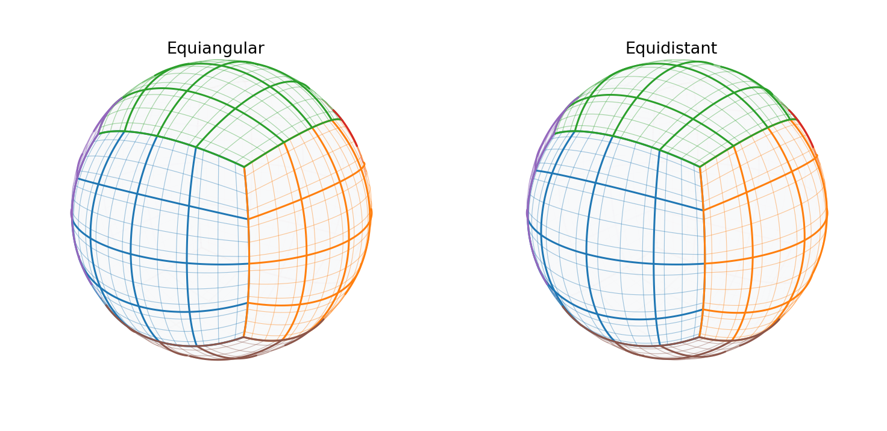
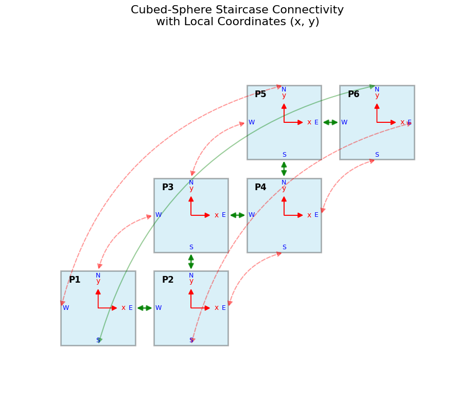
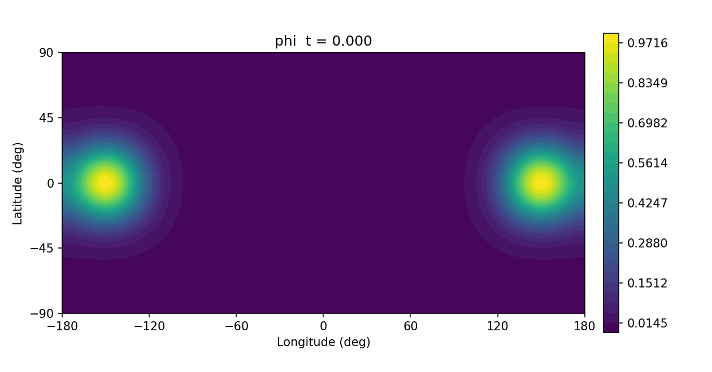
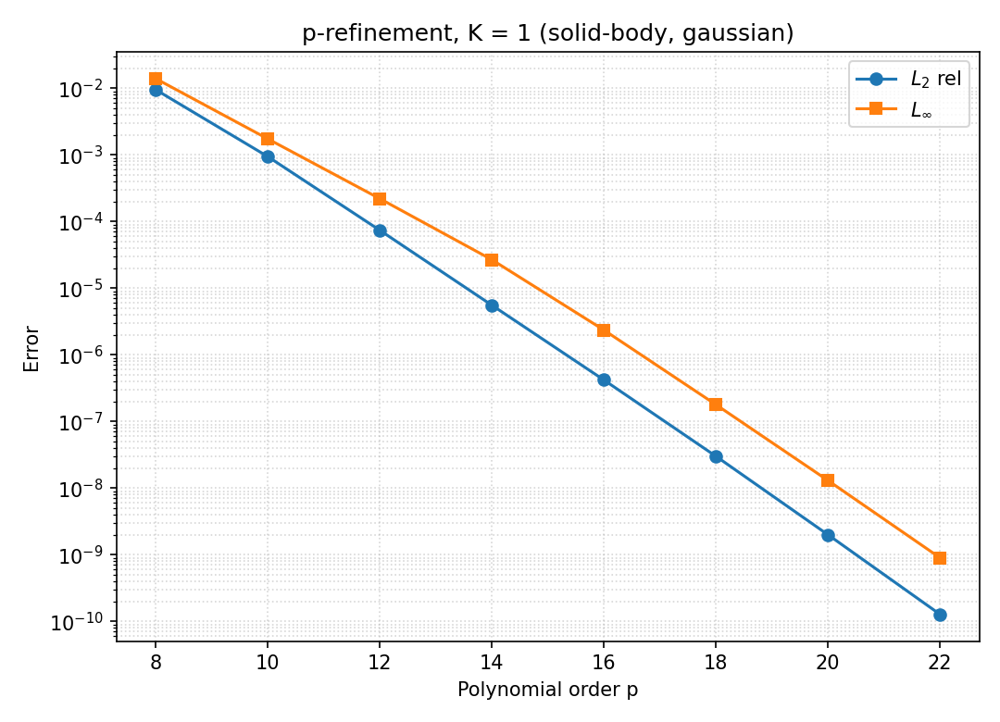
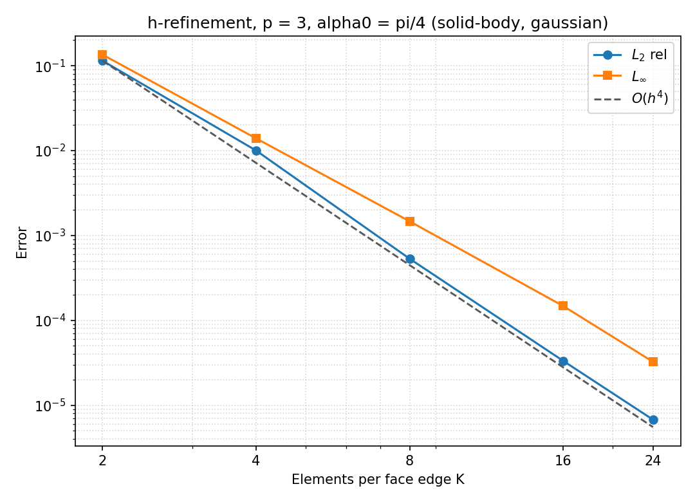
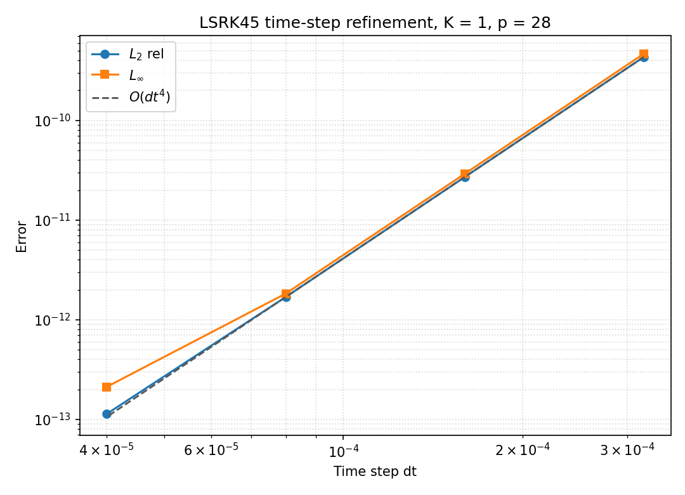

# cubesphere：Cubed-Sphere 譜元素傳輸求解器（`Rust` + `cuda-oxide`）

[English](README.md) | **繁體中文**

高效能、可擴充、模組化的球面立方體（Cubed-Sphere）高階譜元素平流傳輸求解器。本專案將原始大學專題研究原型（[`P2_new.ipynb`](archive/prototype/P2_new.ipynb)）重構為符合工程標準的 **純 Rust Workspace 套件架構**，並為 **原生 Windows 11 (`x86_64-pc-windows-msvc`) 與 WSL2 (Ubuntu 24.04) + NVIDIA RTX 5070 Ti (`sm_120`)** 打造獨立隔離的 [`NVIDIA/cuda-rust`](https://github.com/NVIDIA/cuda-rust)（`cuda-oxide`）純 Rust GPU 加速後端。

---

## 目錄

- [系統架構（6 + 1 Crates）](#系統架構6--1-crates)
- [相對於原型 `P2_new.ipynb` 的核心數值與架構升級](#相對於原型-p2_newipynb-的核心數值與架構升級)
- [快速開始（CPU Workspace 與 CLI）](#快速開始cpu-workspace-與-cli)
- [ParaView 三維視覺化（`.vtu` / `.pvd`）](#paraview-三維視覺化vtu--pvd)
- [出圖腳本（`scripts/`）](#出圖腳本scripts)
- [實測收斂性與效能基準數據（CPU `--release`）](#實測收斂性與效能基準數據cpu---release)
- [GPU 加速後端（`cuda-oxide` / RTX 5070 Ti 原生 Windows & WSL2）](#gpu-加速後端cuda-oxide--rtx-5070-ti-原生-windows--wsl2)
- [保留的原始專題檔案](#保留的原始專題檔案)
- [授權與引用](#授權與引用)

---

## 系統架構（6 + 1 Crates）

根 Workspace 包含 6 個純 Rust CPU Crates，能直接在任何無 GPU／無 CUDA Toolkit 環境完成建置與全套測試；CUDA 後端則刻意以獨立 Workspace 隔離在 `crates/cubesphere-backend-cuda/`，透過共同的 [`ComputeBackend<T>`](crates/cubesphere-solver/src/backend.rs) Trait 與物理／時間積分核心無縫對接：

```
cubesphere/
├── crates/
│   ├── cubesphere-core/          # FloatScalar (f64/f32)、LGL 參考元素、Equiangular/Equidistant 投影、6*K*K 多元素拓撲
│   ├── cubesphere-equations/     # Equation / ScalarAdvection、3D 剛體旋轉風場、Nair-Lauritzen Case 4 變形流、初始場
│   ├── cubesphere-solver/        # ComputeBackend<T> 抽象介面、NumericalFlux（upwind/central/α）、半徑解耦 CFL 步長、Carpenter-Kennedy 5-stage LSRK45
│   ├── cubesphere-backend-cpu/   # Rayon 多核心並行後端（Split-Form 散度 + SAT 邊界懲罰）、整合驗證測試、examples/solid_body.rs
│   ├── cubesphere-io/            # 完整 f64 表面積分誤差分析、離散能量診斷、VTK (.vtu/.pvd) 匯出、CSV/JSON 報表
│   ├── cubesphere-cli/           # 命令列工具 `cubesphere`：info / run / converge / bench
│   └── cubesphere-backend-cuda/  # [獨立隔離 Workspace] NVIDIA/cuda-rust (cuda-oxide) SIMT GPU 後端 + gpu_parity 對拍程式
├── scripts/                      # Python 出圖腳本：收斂曲線、3D 網格、PVD → GIF 動畫
├── docs/
│   ├── images/                   # README 使用的圖片（由 scripts/ 產生）
│   ├── WINDOWS_CUDA_OXIDE.md     # 原生 Windows 11 (MSVC) + RTX 5070 Ti (sm_120) 完整安裝與驗證手冊
│   └── WSL2_CUDA_OXIDE.md        # Windows 11 + WSL2 Ubuntu 24.04 替代方案手冊
├── archive/prototype/            # 原始專題檔案：P2_new.ipynb、NPDE.pdf、模擬 GIF
├── .github/workflows/ci.yml      # CI：fmt、clippy、三平台測試、文件、MSRV、出圖腳本
├── index.html                    # GitHub Pages 互動式展示
└── Cargo.toml                    # 根 Workspace 設定（exclude = ["crates/cubesphere-backend-cuda"]）
```

依賴關係採用嚴格單向分層（Dependency Inversion）：

```
cubesphere-cli ──► cubesphere-backend-cpu / cubesphere-io ──► cubesphere-solver (ComputeBackend<T>) ──► cubesphere-equations ──► cubesphere-core
                                              ▲
                                              │ （實作相同 Trait，不入侵純 CPU 建置）
cubesphere-backend-cuda (standalone) ─────────────────┘
```

---

## 相對於原型 `P2_new.ipynb` 的核心數值與架構升級

1. **修正保守型 SBP-SAT 邊界懲罰項（消除質量誤差）**
   - 修正早期原型在 SAT 懲罰項中誤除面積膨脹因子 $\sqrt{g}$ 的數學瑕疵，使邊界通量與張量積 LGL 質量矩陣權重嚴格對偶抵銷。
   - 在任何球半徑 $R$、任意多元素加密 $(K, p)$、兩種幾何投影及時變變形流場下，全域離散質量相對誤差穩定維持在機器精度（$\sim 10^{-15}$）。
2. **半徑解耦的 CFL 穩定性估計**
   - `compute_cfl_dt` 以逆變角速度上限 $\nu_{\max} = \max(|u^\alpha| + |u^\beta|)$ 計算時間步長：
     $$\Delta t = \text{CFL} \cdot \frac{\pi}{2 K p^2 \nu_{\max}}$$
   - 徹底取代原本寫死角座標常數的估計方式，對不同球半徑 $R$（含地球尺度的單位週期流場）均具備完全尺度不變性。
3. **無極點奇異性的 3D 剛體旋轉風場與投影基底**
   - `SolidBodyRotation` 直接在三維笛卡兒空間以 $\mathbf{u} = \boldsymbol{\omega} \times \mathbf{r}$ 求值，再經雙正交逆變基底向量 $\mathbf{e}^\alpha, \mathbf{e}^\beta$ 投影至面板局部座標，完全消除傳統球座標 $(u_\lambda, v_\theta)$ 在南北極點的 $\cos\theta \to 0$ 奇異問題（已通過 $\alpha_0 = \pi/2$ 直接跨極平流之指數收斂驗證）。
4. **一般化 $K \times K$ 多元素網格與雙投影架構**
   - 從單面板 $K=1$ 擴充為每面 $K \times K$、全系統 $6K^2$ 元素的階梯式（Staircase）互連拓撲，並支援 `Equiangular`（等角日晷投影）與 `Equidistant`（等距投影）自由切換。
   - 兩種投影都有解析 Jacobian，並以單元測試對照數值度量：等角 $\sqrt{g} = R^2/(\rho^3\cos^2\alpha\cos^2\beta)$；等距 $x = 4\alpha/\pi,\ y = 4\beta/\pi$，$\sqrt{g} = (4/\pi)^2 R^2/\rho^3$，其中 $\rho = \sqrt{1+x^2+y^2}$。

   

   
5. **高難度基準測試與真確物理誤差範數**
   - 新增 **Nair & Lauritzen (2010) Case 4** 時變無輻散變形流＋雙高斯鐘形（`twin-gaussian`）動態流場基準，完整驗證細絲拉伸與週期回歸精度。
   - `cubesphere-io` 以全域高階 $f64$ LGL 表面求積計算正規化 $L_1$、$L_2$ 相對誤差與 $L_\infty$ 誤差（區分絕對與相對範數），並支援自由流常數場（Freestream Preservation）驗證。
6. **`FloatScalar` 泛型精度架構（`f64` / `f32`）**
   - 幾何與正交基底於事前計算階段一律使用高精度 `f64`，運行時期可透過同一套介面切換 `f64` 或 `f32`，兼顧數值嚴謹性與消費級顯示卡 FP32 記憶體頻寬優勢。
7. **Neumaier 補償時間積分累加（消除數萬步後端點時間飄移）**
   - 原本在 $10^4$–$5\times 10^4$ 步長下使用標準浮點數累加 `current_time += dt_actual`，會在終點 `T_final - current_time` 累積 $\sim 10^{-13}$ 時間飄移，使高精度譜元素解在 $\sim 2\times 10^{-12}$–$5\times 10^{-12}$ 提前觸底反彈。
   - [`run_lsrk45_with_dt`](crates/cubesphere-solver/src/lsrk45.rs#L140) 改以 `neumaier_add` 雙精度補償求積追蹤物理時間，突破瓶頸並穩定下探至 `f64` 雙精度舍入底線（$L_2 \sim 3.39\times 10^{-14}$）。
8. **可選數值通量（α-flux 族）與離散能量診斷**
   - [`NumericalFlux`](crates/cubesphere-solver/src/flux.rs) 提供 `Upwind`（預設）、`Central` 與 `Blended(α)`，SAT 懲罰統一為 $-\tfrac12(v_n - \alpha|v_n|)(q_{\text{out}} - q_{\text{in}})/w$，CPU 與 CUDA 後端共用同一公式；所有 α 皆維持機器精度的質量守恆。
   - `cubesphere-io` 新增離散能量 $E = \int_{S^2} \phi^2\,dS$（與 SBP 質量矩陣同一組 LGL 權重），`ErrorMetrics` 增加 `energy_initial` / `energy_final` / `energy_rel_change`。
   - 驗證測試直接檢查半離散算子的能量結構：central 通量下 $ML + L^TM$ 為對角矩陣（介面耦合完全不交換能量）；upwind 額外貢獻 $-\sum|\sqrt{g}\,u_n|\,w\,[\![q]\!]^2 \le 0$，且與 α 成線性。central 通量剩下的微小能量變化來自插值風場的離散散度與 LSRK45 本身，並非介面項。

---

## 快速開始（CPU Workspace 與 CLI）

確認系統已安裝標準穩定版 Rust 工具鏈（1.87+），即可進行編譯、測試與執行：

```bash
# 1. 編譯並執行全套單元測試與整合驗證測試（Release 模式速度快數倍）
cargo test --release --workspace

# 2. 靜態檢查（零警告通過）
cargo clippy --workspace --all-targets -- -D warnings

# 3. 編譯最佳化 CLI 執行檔（產出至 target/release/cubesphere）
cargo build --release -p cubesphere-cli

# 4. 以 library 方式使用：一圈斜角剛體旋轉並與解析解比較
cargo run --release -p cubesphere-backend-cpu --example solid_body
```

### 常用 CLI 子指令範例

```bash
# 檢視網格自由度與全球表面積積分精度
./target/release/cubesphere info --k 8 --order 4 --projection equiangular

# 執行經典 Solid-Body Rotation（斜角 45 度跨面板角點），並匯出 VTK 與 JSON 診斷
./target/release/cubesphere run \
  --k 8 --order 4 --wind solid-body --initial gaussian \
  --alpha0-deg 45 --periods 1.0 --cfl 0.5 \
  --vtk-out out/solid_final.vtu --json-out out/solid_metrics.json

# 指定固定時間步長 --dt 與高斯初始場寬度 --sigma-ratio
./target/release/cubesphere run \
  --k 4 --order 14 --wind solid-body --initial gaussian \
  --dt 3.758e-5 --sigma-ratio 0.3333333333333333

# 執行 Nair & Lauritzen Case 4 變形流，並輸出時間序列動畫（ParaView PVD + VTU）
./target/release/cubesphere run \
  --k 8 --order 5 --wind deformational --initial twin-gaussian \
  --periods 1.0 --frames 20 --pvd-dir out/deform_anim

# p-refinement 收斂階數測試（固定 K=1，高階多項式加密，並匯出 CSV）
./target/release/cubesphere converge \
  --mode p --k 1 --orders 8,10,12,14,16,18,20,22 \
  --alpha0 0 --wind solid-body --initial gaussian --csv-out out/p_conv.csv

# h-refinement 四階空間收斂測試（固定 p=3，理論階數 O(h^4)）
./target/release/cubesphere converge \
  --mode h --ks 2,4,8,16,24 --order 3 \
  --alpha0-deg 45 --wind solid-body --initial gaussian

# h-refinement 收斂階數測試（固定 p=5，Deformational Case 4 空間加密）
./target/release/cubesphere converge \
  --mode h --ks 4,8,12 --order 5 \
  --wind deformational --initial twin-gaussian

# 時間步長 dt-refinement 收斂階數測試（LSRK45 4 階時間收斂 O(dt^4)）
./target/release/cubesphere converge \
  --mode t --k 1 --order 28 --alpha0 0 \
  --wind solid-body --initial gaussian --dts 3.2e-4,1.6e-4,8.0e-5,4.0e-5

# CPU Rayon 多執行緒吞吐量基準測試（f64 vs f32）
./target/release/cubesphere bench --k 16 --order 4 --steps 200 --precision f64
./target/release/cubesphere bench --k 16 --order 4 --steps 200 --precision f32

# 比較數值通量：--flux upwind（預設）| central | 0~1 之間的 α（混合通量）
# --frames 會額外印出能量時間序列，並寫入 JSON 的 energy_history
./target/release/cubesphere run \
  --k 4 --order 3 --wind solid-body --initial gaussian --alpha0-deg 45 \
  --flux central --frames 10 --json-out out/central_metrics.json
```

`run` 的 JSON 報表在原本的誤差欄位之外，新增 `flux`、`energy_initial`、`energy_final`、`energy_rel_change`，使用 `--frames` 時另有 `energy_history`。

完整參數說明請執行 `./target/release/cubesphere --help`。

---

## ParaView 三維視覺化（`.vtu` / `.pvd`）

`cubesphere-io` 將每個 $(p+1)\times(p+1)$ 譜元素細分為 $p\times p$ 個 `VTK_QUAD` 網格單元，無須外部相依函式庫即可直接呈現高階曲面與局部誤差分佈：

- **時間序列動畫**：使用 `--pvd-dir <dir> --frames <N>` 會產生 `<dir>/frame.pvd` 與 `frame_0000.vtu ...`。在 **ParaView** 開啟 `frame.pvd` 並按 Play，即可直接觀察標量場 $\phi$ 跨越多個面板與極區的演化過程。
- **單步完整誤差診斷**：使用 `--vtk-out <file.vtu>` 會寫入以下 PointData 欄位：
  - `phi`：終點時刻數值解
  - `initial`：初始場 $\phi(0)$
  - `exact`：解析精確解（若所選流場與時刻具備解析解）
  - `error`：逐點誤差 $\phi_{\text{num}} - \phi_{\text{exact}}$
  - `sqrt_g`：局部幾何 Jacobian 膨脹因子 $\sqrt{g}$

不想開 ParaView 時，可用 [`scripts/pvd_to_gif.py`](scripts/pvd_to_gif.py) 把 PVD 序列轉成經緯度展開的 GIF。下圖是上方 Nair & Lauritzen Case 4 指令（$K=8, p=5$，`twin-gaussian`）的輸出：雙高斯鐘在 $T/2$ 被拉成細絲，到 $T$ 回到原位。



---

## 出圖腳本（`scripts/`）

三支獨立的 Python 腳本，只依賴 `numpy`、`matplotlib`、`Pillow`（不需 ParaView 或 VTK 函式庫）。README 中的圖片都由它們產生：

| 腳本 | 輸入 | 輸出 |
| --- | --- | --- |
| [`plot_convergence.py`](scripts/plot_convergence.py) | `cubesphere converge --csv-out` 的 CSV（可多個疊圖） | 自動判斷 h / p / t 加密模式；h 模式附 $O(h^{p+1})$、t 模式附 $O(\Delta t^4)$ 參考線 |
| [`plot_grids.py`](scripts/plot_grids.py) | `--k`、`--order` | 兩種投影的 3D 元素網格與 LGL 節點線（與求解器相同的六面映射） |
| [`pvd_to_gif.py`](scripts/pvd_to_gif.py) | `cubesphere run --pvd-dir` 的 `frame.pvd` | 經緯度展開的動畫 GIF，所有影格共用色階 |

```bash
pip install numpy matplotlib pillow

# 收斂曲線（先用 cubesphere converge --csv-out 產生 CSV）
python scripts/plot_convergence.py out/p_conv.csv -o docs/images/p_convergence.png
python scripts/plot_convergence.py a.csv b.csv --labels Equiangular Equidistant -o cmp.png

# 3D 網格（--order 0 只畫元素邊界）
python scripts/plot_grids.py --k 4 --order 4 -o docs/images/grids.png

# PVD 時間序列 → GIF（--every 2 表示每兩格取一格）
python scripts/pvd_to_gif.py out/deform_anim/frame.pvd -o docs/images/deformational.gif --fps 6
```

---

## 實測收斂性與效能基準數據（CPU `--release`）

以下所有數據皆於標準無 GPU 雲端環境實測取得（硬體規格：**Intel Xeon Platinum 8481C，2 vCPUs**，`cargo build --release`）：

### 1. 單面板譜收斂（$p$-refinement，$K=1, \alpha_0=0$, `gaussian`, `Equiangular`, $\text{CFL}=0.5$）

對應原始 [`P2_new.ipynb`](archive/prototype/P2_new.ipynb) 的單元素設定，展現純粹指數型譜收斂與 $10^{-15}$ 質量守恆：

| $K$ | $p$ | Total DOFs | Steps | $L_2$ 相對誤差 | $p$ 收斂階 | $L_\infty$ 誤差 | 質量相對誤差 | 耗時 (s) |
| --- | --- | --- | --- | --- | --- | --- | --- | --- |
| 1 | 8 | 486 | 768 | `9.5035e-3` | - | `1.3937e-2` | `1.155e-15` | 0.104 |
| 1 | 10 | 726 | 1200 | `9.4310e-4` | 10.35 | `1.7401e-3` | `1.650e-15` | 0.199 |
| 1 | 12 | 1014 | 1728 | `7.3873e-5` | 13.97 | `2.2024e-4` | `1.485e-15` | 0.366 |
| 1 | 14 | 1350 | 2352 | `5.5528e-6` | 16.79 | `2.6725e-5` | `9.900e-16` | 0.615 |
| 1 | 16 | 1734 | 3072 | `4.1894e-7` | 19.35 | `2.3529e-6` | `9.900e-16` | 0.967 |
| 1 | 18 | 2166 | 3888 | `3.0030e-8` | 22.38 | `1.7859e-7` | `1.650e-15` | 1.473 |
| 1 | 20 | 2646 | 4800 | `1.9961e-9` | 25.73 | `1.3001e-8` | `4.950e-16` | 2.314 |
| 1 | 22 | 3174 | 5808 | `1.2738e-10` | 28.87 | `8.9978e-10` | `1.320e-15` | 3.179 |



### 2. 多元素 $h$-refinement（$\alpha_0=\pi/4$ 橫跨立方角點, `gaussian`, `Equiangular`）

#### (a) $p=3$ 四階空間收斂驗證（理論階數 $O(h^{p+1}) = O(h^4)$）

| $K$ | $p$ | Total DOFs | Steps | $L_2$ 相對誤差 | $h$ 收斂階 | $L_\infty$ 誤差 | $h$ 收斂階 | 質量相對誤差 | 耗時 (s) |
| --- | --- | --- | --- | --- | --- | --- | --- | --- | --- |
| 2 | 3 | 384 | 306 | `1.1438e-1` | - | `1.3499e-1` | - | `8.226e-16` | 0.079 |
| 4 | 3 | 1536 | 611 | `1.0010e-2` | 3.51 | `1.3924e-2` | 3.28 | `2.145e-15` | 0.242 |
| 8 | 3 | 6144 | 1222 | `5.3153e-4` | **4.24** | `1.4668e-3` | 3.25 | `1.980e-15` | 0.922 |
| 16 | 3 | 24576 | 2444 | `3.3275e-5` | **4.00** | `1.4743e-4` | 3.31 | `1.815e-15` | 4.785 |
| 24 | 3 | 55296 | 3666 | `6.7526e-6` | **3.93** | `3.2451e-5` | 3.73 | `8.250e-16` | 14.469 |



#### (b) $p=4$ 五階空間收斂驗證（理論階數 $O(h^5)$）

| $K$ | $p$ | Total DOFs | Steps | $L_2$ 相對誤差 | $h$ 收斂階 | $L_\infty$ 誤差 | $h$ 收斂階 | 質量相對誤差 | 耗時 (s) |
| --- | --- | --- | --- | --- | --- | --- | --- | --- | --- |
| 2 | 4 | 600 | 544 | `2.9634e-2` | - | `5.9704e-2` | - | `8.251e-16` | 0.105 |
| 4 | 4 | 2400 | 1087 | `1.0527e-3` | 4.82 | `3.3941e-3` | 4.14 | `3.960e-15` | 0.331 |
| 8 | 4 | 9600 | 2173 | `3.1758e-5` | **5.05** | `1.3702e-4` | 4.63 | `2.970e-15` | 1.592 |
| 16 | 4 | 38400 | 4345 | `1.1080e-6` | **4.84** | `3.5704e-6` | 5.26 | `2.475e-15` | 10.660 |

### 3. LSRK45 時間步長收斂與機器精度驗證（Neumaier 補償修正後）

#### (a) 顯式時間步長收斂驗證（`--mode t`，$K=1, p=28, \alpha_0=0$, `gaussian`, `SolidBodyRotation`, $T=1.0$）

| $K$ | $p$ | $\Delta t$ | Steps | $L_2$ 相對誤差 | 時間收斂階 | $L_\infty$ 誤差 | 時間收斂階 | 質量相對誤差 | 耗時 (s) |
| --- | --- | --- | --- | --- | --- | --- | --- | --- | --- |
| 1 | 28 | `3.2000e-4` | 3125 | `4.3341e-10` | - | `4.6704e-10` | - | `0.000e0` | 3.489 |
| 1 | 28 | `1.6000e-4` | 6250 | `2.7088e-11` | **4.00** | `2.9165e-11` | **4.00** | `3.300e-16` | 6.885 |
| 1 | 28 | `8.0000e-5` | 12500 | `1.6925e-12` | **4.00** | `1.8331e-12` | **3.99** | `0.000e0` | 13.777 |
| 1 | 28 | `4.0000e-5` | 25000 | `1.1331e-13` | **3.90** | `2.0953e-13` | 3.13 | `8.250e-16` | 27.569 |



#### (b) `f64` 機器精度底線驗證（對比修正前 $\sim 3.6\times 10^{-12}$ 時間累加飄移平台）

| 算例與網格 | $\text{CFL}$ | Steps | $L_1$ 相對誤差 | $L_2$ 相對誤差 | $L_2$ 絕對誤差 | $L_\infty$ 誤差 | 質量相對誤差 |
| --- | --- | --- | --- | --- | --- | --- | --- |
| 常數自由流 (`constant`, $K=1, p=32$) | 0.5 | 12288 | **`0.0000e0`** | **`0.0000e0`** | **`0.0000e0`** | **`0.0000e0`** | `0.000e0` |
| 單元素高斯鐘 (`gaussian`, $K=1, p=32$) | 0.5 | 12288 | `1.8777e-12` | `1.8117e-12` | `1.0606e-12` | `1.9935e-12` | `1.650e-16` |
| 單元素高斯鐘 (`gaussian`, $K=1, p=32$) | 0.25 | 24576 | `1.1853e-13` | `1.1602e-13` | `6.7914e-14` | `1.4966e-13` | `3.300e-16` |
| 單元素高斯鐘 (`gaussian`, $K=1, p=32$) | 0.125 | 49152 | **`2.9864e-14`** | **`3.3926e-14`** | **`1.9859e-14`** | **`6.8057e-14`** | `3.465e-15` |
| 多元素斜角平流 (`gaussian`, $K=4, p=14, \alpha_0=\pi/4$) | 0.25 | 26610 | **`6.8471e-14`** | **`6.5495e-14`** | **`3.8339e-14`** | **`2.0495e-13`** | `1.320e-15` |

### 4. 直接跨南北極 $p$-refinement（$K=2, \alpha_0=\pi/2$, `gaussian`, `Equiangular`）

驗證零極區座標奇異性，於 1 圈旋轉直接通過地球南北極後依然保持平滑指數收斂：
`p=4` ($1.7399\times 10^{-2}$) $\to$ `p=6` ($4.0917\times 10^{-4}$) $\to$ `p=8` ($3.3846\times 10^{-5}$) $\to$ `p=10` ($2.5137\times 10^{-6}$) $\to$ `p=12` ($1.0398\times 10^{-7}$, $L_\infty = 1.2640\times 10^{-7}$, 質量誤差 `0.000e0`, 全程耗時 `3.490s`)。

### 5. Nair & Lauritzen (2010) Case 4 時變變形流 $h$-refinement（$p=5$, `twin-gaussian`, $T=5.0$）

| $K$ | $p$ | Total DOFs | Steps | $L_2$ 相對誤差 | $h$ 收斂階 | $L_\infty$ 誤差 | $h$ 收斂階 | 質量相對誤差 | 耗時 (s) |
| --- | --- | --- | --- | --- | --- | --- | --- | --- | --- |
| 4 | 5 | 3456 | 3406 | `1.7752e-1` | - | `2.0239e-1` | - | `9.133e-16` | 2.982 |
| 8 | 5 | 13824 | 6811 | `2.1385e-2` | 3.05 | `3.1300e-2` | 2.69 | `3.836e-15` | 22.051 |
| 12 | 5 | 31104 | 10216 | `2.4182e-3` | 5.38 | `5.1246e-3` | 4.46 | `2.375e-15` | 75.321 |

### 6. CPU Rayon 吞吐量基準（`cubesphere bench`, 200 steps = 1000 LSRK45 階段）

| 網格設定 | Total DOFs | 精度 | 200 步耗時 (s) | 單步時間 (ms/step) | 吞吐量 (`MDOF-stages/s`) |
| --- | --- | --- | --- | --- | --- |
| `K=8, p=4` | 9,600 | `f64` | 0.2340 | 1.170 | **41.03** |
| `K=8, p=4` | 9,600 | `f32` | 0.2062 | 1.031 | **46.57** |
| `K=16, p=4` | 38,400 | `f64` | 0.6149 | 3.074 | **62.45** |
| `K=16, p=4` | 38,400 | `f32` | 0.6088 | 3.044 | **63.07** |

### 7. 數值通量與離散能量（$K=4, p=3, \alpha_0=\pi/4$, Solid-Body 1 圈, $\text{CFL}=0.5$）

刻意使用偏粗網格，讓介面跳躍明顯。數據為本機（Windows 11，RTX 5070 Ti 工作站的 CPU）`cubesphere run --flux ...` 實測：

| 初始場 | 通量 | 能量相對變化 $E(T)/E(0)-1$ | $L_2$ 相對誤差 | 質量相對誤差 |
| --- | --- | --- | --- | --- |
| `gaussian` | `upwind` | `-1.590e-3`（單調遞減） | `1.0010e-2` | `1.815e-15` |
| `gaussian` | `0.5` | `-1.008e-3` | `9.2260e-3` | `2.310e-15` |
| `gaussian` | `central` | `+1.060e-5`（正負擺盪） | `1.5406e-2` | `1.980e-15` |
| `cosine` | `upwind` | `-2.509e-1` | `3.6065e-1` | `2.695e-16` |
| `cosine` | `central` | `-3.524e-5` | `6.2857e-1` | `3.638e-15` |

upwind 以耗散換取較小的誤差；central 幾乎不耗散能量，但色散誤差較大（`cosine` 只有 $C^1$ 連續，差異更明顯）。

---

## GPU 加速後端（`cuda-oxide` / RTX 5070 Ti 原生 Windows & WSL2）

[`crates/cubesphere-backend-cuda`](crates/cubesphere-backend-cuda/src/lib.rs) 使用 NVIDIA 官方開源的純 Rust GPU 工具鏈 [`NVIDIA/cuda-rust`](https://github.com/NVIDIA/cuda-rust)（`cuda-oxide`）實作 `ComputeBackend<T>`（支援 `f64` 與 `f32`），核心技術設計包含：

- **單執行緒單自由度（1-thread-per-DOF）融合核心**：`split_form_and_sat_{f64,f32}` 將體積項分裂散度與 4 條邊的 α-flux SAT 邊界懲罰（`CudaBackend::with_flux`，預設 upwind）融合成單一 Kernel，透過只讀切片與 `u64` 位元封裝鄰接表存取跨面板鄰居，徹底消除角點競爭與原子操作鎖。
- **零超越函數的 Nair-Lauritzen 裝置端風場核心**：`update_nair_lauritzen_comp_{f64,f32}` 利用三角加倍角公式將時變風場拆為預先快取的空間緩衝區＋每階段僅 3 個純量 $(c_{2\omega t}, s_{2\omega t}, k_t)$，裝置端零 `sin`/`cos` 呼叫，免除 `#![no_std]` `libdevice` 依賴與精度漂移。
- **快取預編譯啟動檢查（`PreparedLaunch`）與零動態 Host-Device 拷貝**：初始化時即把所有幾何指標、微分矩陣、鄰接表上傳並完成驅動合約準備，LSRK45 時間積分迴圈全程常駐 VRAM。
- **完整雙平台對拍程式**：[`gpu_parity.rs`](crates/cubesphere-backend-cuda/src/bin/gpu_parity.rs) 會自動驗證 Solid-Body (`f64` $< 10^{-13}$)、Nair-Lauritzen Case 4 (`f64` $< 10^{-12}$)、central / α=0.5 混合通量對拍、`f32` 對拍及高解析度 (`K=16/32`) 相對於 CPU Rayon 的實際加速比。

> **執行環境說明**：純 Rust CPU Workspace（6 個 Crates）已於本機／雲端完成完整驗證；`crates/cubesphere-backend-cuda` 需要實體 NVIDIA GPU、驅動程式與 CUDA Toolkit / `libclang` / `rust 1.99.1`，已在原生 Windows 11 + RTX 5070 Ti（driver 621.01、CUDA 12.9、`cargo-oxide 0.4.0`、`sm_120a`）以 `gpu_parity` 全數通過（f64 GPU 與 CPU 差異約 $10^{-15}$）。`cargo-oxide 0.4.0` 的 `build` / `run` 不再接受 `--release`，預設即為 release profile。上游 `NVIDIA/cuda-rust` 現已正式支援 **原生 Windows 11 (`x86_64-pc-windows-msvc`)** 與 **WSL2 Ubuntu 24.04**：

- **原生 Windows 11 + RTX 5070 Ti 完整安裝與驗證手冊**：[`docs/WINDOWS_CUDA_OXIDE.md`](docs/WINDOWS_CUDA_OXIDE.md)
- **WSL2 Ubuntu 24.04 替代方案手冊**：[`docs/WSL2_CUDA_OXIDE.md`](docs/WSL2_CUDA_OXIDE.md)
- **GPU 後端快速說明**：[`crates/cubesphere-backend-cuda/README.md`](crates/cubesphere-backend-cuda/README.md)

```powershell
# 在 Developer PowerShell for VS 2022 (依 docs/WINDOWS_CUDA_OXIDE.md 設好環境後執行)：
cd crates\cubesphere-backend-cuda
cargo oxide doctor
cargo oxide setup
cargo oxide build
cargo oxide run --bin gpu_parity
```

---

## 保留的原始專題檔案

原始大學專題檔案保留在 [`archive/prototype/`](archive/prototype/)，內容未做任何更動，便於日後比對與重現原始研究結果：

- [`P2_new.ipynb`](archive/prototype/P2_new.ipynb)：原始 Jupyter Notebook 數學原型
- [`NPDE.pdf`](archive/prototype/NPDE.pdf)：課程專題報告
- [`spherical_advection_clean.gif`](archive/prototype/spherical_advection_clean.gif)：原始模擬動態輸出圖檔
- [`index.html`](index.html)：原始互動式網頁展示。它是 GitHub Pages 的首頁，所以留在根目錄。

---

## 授權與引用

本專案以 [MIT License](LICENSE) 授權。若在研究中使用，請依 [`CITATION.cff`](CITATION.cff) 引用（GitHub 頁面右側的「Cite this repository」會自動產生 BibTeX）。貢獻方式請見 [`CONTRIBUTING.md`](CONTRIBUTING.md)，版本變更紀錄請見 [`CHANGELOG.md`](CHANGELOG.md)。
